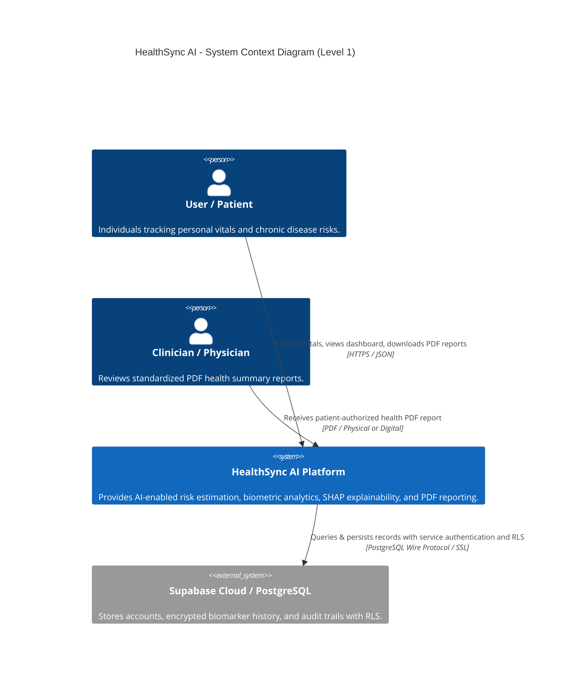
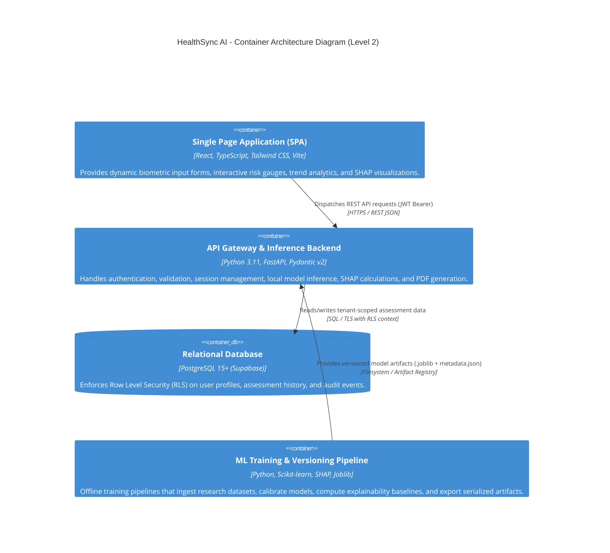
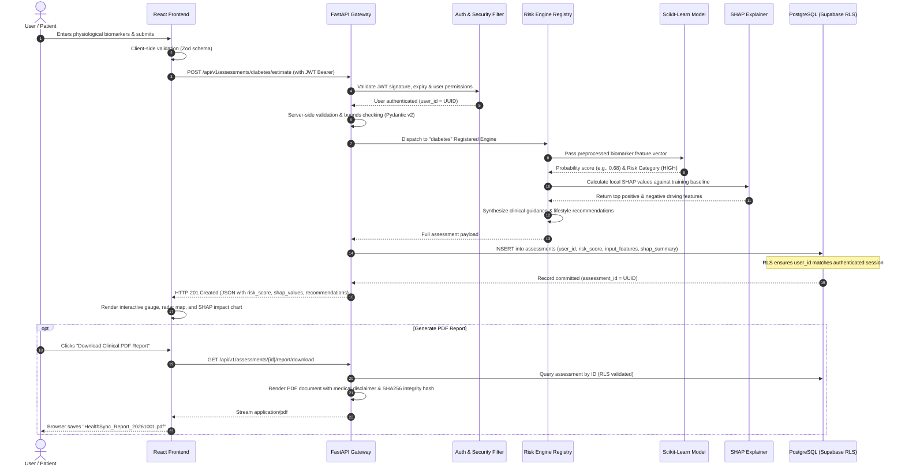

# HealthSync AI — System Architecture Specification

> **Official Project Title:** AI-Enabled Smart Health Monitoring System  
> **Product Name:** HealthSync AI  
> **Version:** 1.0.0  
> **Status:** Approved for Technical Baseline  
> **Target Environment:** Multi-tier Modular Monorepo  

---

## 1. High-Level Architecture Diagram

HealthSync AI follows a clean, decoupled 3-tier architecture with an asynchronous pipeline for machine learning artifact development:





---

## 2. Modular Monorepo Structure

The repository is organized into distinct, decoupled domains to ensure clean boundary enforcement, independent dependency management, and frictionless CI/CD pipelines:

```
HealthSync-AI/
├── .github/                      # CI/CD workflows, automated testing & linting
├── docs/                         # Technical architecture & design documentation
│   ├── PROJECT_OVERVIEW.md
│   ├── ARCHITECTURE.md
│   ├── DATABASE_DESIGN.md
│   ├── API_DESIGN.md
│   ├── ML_DESIGN.md
│   ├── SECURITY_AND_PRIVACY.md
│   └── DEVELOPMENT_ROADMAP.md
├── AGENTS.md                     # Coding rules & AI agent operational directives
│
├── frontend/                     # Client Application
│   ├── public/                   # Static assets (favicons, report templates, logos)
│   ├── src/
│   │   ├── assets/               # Local styles and images
│   │   ├── components/           # Reusable UI library (Gauges, Charts, Modals, Forms)
│   │   │   ├── common/           # Buttons, Inputs, Cards, Alert banners, Tooltips
│   │   │   ├── layout/           # Navbar, Sidebar, Footer, Responsive wrapper
│   │   │   ├── dashboard/        # Trend graphs, Vitals summary, Risk badges
│   │   │   └── explainability/   # SHAP waterfall charts, Feature impact meters
│   │   ├── features/             # Domain-specific modules
│   │   │   ├── auth/             # Login, Register, Session context
│   │   │   ├── diabetes/         # Diabetes input form, validation, results view
│   │   │   ├── heart/            # Cardiovascular input form, validation, results view
│   │   │   └── reports/          # PDF report preview, download trigger
│   │   ├── hooks/                # Custom React hooks (useAuth, useAssessment, useTrends)
│   │   ├── services/             # API HTTP client layer (Axios / Fetch with interceptors)
│   │   ├── types/                # TypeScript interfaces mapped to OpenAPI schemas
│   │   ├── utils/                # Formatters, date helpers, risk color scales
│   │   ├── App.tsx               # Root application router & providers
│   │   └── main.tsx              # DOM entrypoint
│   ├── package.json
│   ├── tsconfig.json
│   ├── tailwind.config.js
│   └── vite.config.ts
│
├── backend/                      # Production API & Local Inference Service
│   ├── app/
│   │   ├── api/                  # API routers & endpoint controllers
│   │   │   ├── v1/
│   │   │   │   ├── endpoints/    # auth.py, assessments.py, dashboard.py, reports.py
│   │   │   │   └── router.py     # Aggregated v1 router
│   │   │   └── deps.py           # Dependency injection (DB session, current user, rate limiter)
│   │   ├── core/                 # Core framework setup
│   │   │   ├── config.py         # Pydantic BaseSettings (environment variables)
│   │   │   ├── security.py       # Argon2id hashing, JWT encode/decode, RBAC
│   │   │   ├── database.py       # SQLAlchemy engine & async session factories
│   │   │   ├── logging.py        # Structured JSON logging & audit hooks
│   │   │   └── exceptions.py     # RFC 7807 Problem Detail exception handlers
│   │   ├── engines/              # Extensible Risk Engine Registry
│   │   │   ├── base.py           # Abstract BaseRiskEngine interface
│   │   │   ├── registry.py       # Dynamic Module Registry & Factory
│   │   │   ├── diabetes_engine.py# Concrete Diabetes Risk & SHAP engine
│   │   │   └── heart_engine.py   # Concrete Heart Disease Risk & SHAP engine
│   │   ├── models/               # SQLAlchemy ORM database models
│   │   │   ├── user.py
│   │   │   ├── profile.py
│   │   │   ├── assessment.py
│   │   │   └── audit.py
│   │   ├── schemas/              # Pydantic v2 Data Transfer Objects (DTOs)
│   │   │   ├── auth.py
│   │   │   ├── assessment.py
│   │   │   ├── diabetes.py
│   │   │   ├── heart.py
│   │   │   └── report.py
│   │   ├── services/             # Business logic layer
│   │   │   ├── assessment_service.py
│   │   │   ├── pdf_service.py    # ReportLab / WeasyPrint clinical summary generator
│   │   │   └── audit_service.py
│   │   ├── artifacts/            # Active deployed model binaries & metadata
│   │   │   ├── diabetes/         # diabetes_model_v1.joblib, metadata.json, background.joblib
│   │   │   └── heart/            # heart_model_v1.joblib, metadata.json, background.joblib
│   │   └── main.py               # FastAPI application factory
│   ├── tests/                    # Pytest test suite
│   │   ├── conftest.py           # Test fixtures, mock database, synthetic user fixtures
│   │   ├── test_auth.py
│   │   ├── test_inference.py
│   │   ├── test_explainability.py
│   │   └── test_reports.py
│   ├── alembic/                  # Database migration scripts
│   ├── alembic.ini
│   ├── requirements.txt
│   └── Dockerfile
│
└── ml/                           # Offline Machine Learning & Research Pipelines
    ├── data/
    │   ├── raw/                  # Immutable benchmark datasets (gitignored / checksummed)
    │   │   ├── diabetes_cdc_brfss.csv.sample
    │   │   └── heart_uci_cleveland.csv.sample
    │   ├── processed/            # Cleaned, standardized training partitions
    │   └── synthetic/            # Synthetic fixtures for integration tests
    ├── notebooks/                # Exploratory Data Analysis & experiments
    │   ├── 01_diabetes_eda_and_calibration.ipynb
    │   └── 02_heart_disease_eda_and_calibration.ipynb
    ├── pipelines/                # Reproducible Python training scripts
    │   ├── common/
    │   │   ├── metrics.py        # AUC-ROC, Brier Score, ECE calibration evaluation
    │   │   └── transformers.py   # Custom scikit-learn preprocessing transformers
    │   ├── train_diabetes.py     # Training, cross-validation, calibration & export
    │   └── train_heart.py        # Training, cross-validation, calibration & export
    ├── artifacts/                # Versioned trained model outputs & SHAP baselines
    ├── requirements.txt
    └── README.md
```

---

## 3. End-to-End Component Interaction Flow

The lifecycle of an assessment request from client submission to report generation follows a deterministic path:



---

## 4. Extensibility Pattern: Health Risk Engine Registry

To guarantee that new chronic disease modules (e.g., Hypertension, Kidney Disease, Stroke) can be added without modifying routing logic, database migration schemas, or authentication handlers, HealthSync AI implements the **Registry Pattern** anchored by an abstract base interface.

### 4.1 The Abstract Engine Contract (`BaseRiskEngine`)
Every risk module must implement the following standardized lifecycle:

```python
from abc import ABC, abstractmethod
from typing import Dict, Any, List
from pydantic import BaseModel

class RiskPredictionResult(BaseModel):
    module_name: str
    model_version: str
    risk_score: float             # Calibrated probability in [0.0, 1.0]
    risk_level: str               # "LOW", "MODERATE", "HIGH", "CRITICAL"
    confidence_interval: List[float] # [lower_bound, upper_bound]
    top_risk_factors: List[Dict[str, Any]] # Positive SHAP drivers
    top_protective_factors: List[Dict[str, Any]] # Negative SHAP drivers
    actionable_recommendations: List[str]
    disclaimer: str

class BaseRiskEngine(ABC):
    """Abstract interface that all diagnostic risk estimation modules must implement."""

    @property
    @abstractmethod
    def module_identifier(self) -> str:
        """Unique identifier, e.g., 'diabetes' or 'heart_disease'."""
        pass

    @property
    @abstractmethod
    def model_version(self) -> str:
        """Semantic version of the underlying serialized model artifact."""
        pass

    @abstractmethod
    def validate_inputs(self, raw_input: Dict[str, Any]) -> Dict[str, Any]:
        """Validates biological and lifestyle inputs against physiological feasibility boundaries."""
        pass

    @abstractmethod
    def preprocess(self, validated_input: Dict[str, Any]) -> Any:
        """Transforms validated dictionary into model-ready tensor/numpy array."""
        pass

    @abstractmethod
    def predict(self, feature_array: Any) -> float:
        """Executes calibrated in-memory inference to produce empirical risk probability."""
        pass

    @abstractmethod
    def explain(self, feature_array: Any, top_k: int = 5) -> Dict[str, Any]:
        """Calculates SHAP values to explain individual prediction drivers."""
        pass

    @abstractmethod
    def synthesize_recommendations(self, input_data: Dict[str, Any], shap_summary: Dict[str, Any]) -> List[str]:
        """Generates contextual, evidence-based lifestyle guidance based on high-impact drivers."""
        pass

    def evaluate(self, raw_input: Dict[str, Any]) -> RiskPredictionResult:
        """Template method orchestrating the complete assessment pipeline."""
        validated = self.validate_inputs(raw_input)
        features = self.preprocess(validated)
        probability = self.predict(features)
        explanation = self.explain(features)
        recommendations = self.synthesize_recommendations(validated, explanation)
        
        return RiskPredictionResult(
            module_name=self.module_identifier,
            model_version=self.model_version,
            risk_score=round(probability, 4),
            risk_level=self._map_risk_level(probability),
            confidence_interval=self._compute_ci(probability),
            top_risk_factors=explanation.get("risk_drivers", []),
            top_protective_factors=explanation.get("protective_factors", []),
            actionable_recommendations=recommendations,
            disclaimer="Educational risk screening only. Not a clinical diagnosis."
        )

    @staticmethod
    def _map_risk_level(score: float) -> str:
        if score < 0.20:
            return "LOW"
        if score < 0.50:
            return "MODERATE"
        if score < 0.75:
            return "HIGH"
        return "CRITICAL"

    @staticmethod
    def _compute_ci(score: float) -> List[float]:
        # Standard analytical confidence interval calculation
        margin = max(0.03, 0.08 * (1.0 - abs(score - 0.5) * 2))
        return [max(0.0, round(score - margin, 3)), min(1.0, round(score + margin, 3))]
```

### 4.2 The Module Registry
The `RiskEngineRegistry` automatically discovers and mounts engines upon application startup:

```python
class RiskEngineRegistry:
    _engines: Dict[str, BaseRiskEngine] = {}

    @classmethod
    def register(cls, engine: BaseRiskEngine) -> None:
        cls._engines[engine.module_identifier] = engine

    @classmethod
    def get(cls, module_identifier: str) -> BaseRiskEngine:
        if module_identifier not in cls._engines:
            raise KeyError(f"Health Risk Engine '{module_identifier}' is not installed or enabled.")
        return cls._engines[module_identifier]

    @classmethod
    def list_available_modules(cls) -> List[Dict[str, str]]:
        return [
            {"id": engine.module_identifier, "version": engine.model_version}
            for engine in cls._engines.values()
        ]
```

---

## 5. Technology Stack Selection & Rationale

| Layer | Chosen Technology | Architectural Rationale |
| :--- | :--- | :--- |
| **Frontend Framework** | **React 18+ (TypeScript)** | Strong component ecosystem, declarative UI, robust type safety guaranteeing synchronicity with backend schemas, rapid rendering of complex clinical data visualizations. |
| **Build & Tooling** | **Vite** | Sub-second Hot Module Replacement (HMR), optimized tree-shaken production bundles, modern ES modules support. |
| **CSS & Design System** | **Tailwind CSS (v3)** | Utility-first architecture allowing custom medical-grade aesthetic design, high-contrast dark/light mode toggles, and zero CSS bundle bloat. |
| **State Management** | **Zustand + TanStack Query** | Zustand provides minimalist, un-opinionated client session state; TanStack Query manages asynchronous server state caching, pagination, and invalidation. |
| **Visualizations** | **Recharts & Chart.js** | Canvas/SVG-based responsive time-series charts, radar biometric profiles, and customized horizontal bar charts for SHAP feature attribution. |
| **Backend Framework** | **FastAPI (Python 3.11+)** | High-throughput asynchronous ASGI execution (Starlette), automatic OpenAPI 3.1 schema generation, native Pydantic v2 parsing with Rust-backed validation speed. |
| **ML Runtime** | **Scikit-learn + SHAP (In-Memory)** | Fast tabular inference (<25ms latency), minimal resource overhead, deterministic scoring without external API dependencies, exact tree-based Shapley value computation. |
| **Database** | **PostgreSQL 15+ (Supabase)** | Enterprise ACID compliance, robust JSONB indexing for flexible biomarker storage, native Row Level Security (RLS) ensuring cryptographically isolated multi-tenant data access. |
| **PDF Engine** | **ReportLab / WeasyPrint** | Programmatic, pixel-perfect generation of vector clinical reports with embedded security watermarks and digital SHA256 checksums. |
| **Testing** | **Pytest + Vitest + Playwright** | Pytest for backend unit/integration tests and ML calibration benchmarks; Vitest for frontend component testing; Playwright for end-to-end browser flows. |

---

## 6. Synchronous vs. Asynchronous Workload Strategy

To preserve user responsiveness and prevent thread starvation under concurrent loads:

| Workload Type | Execution Model | Justification & SLAs |
| :--- | :--- | :--- |
| **Risk Scoring & Inference** | **Synchronous (In-Memory)** | Scikit-learn tabular inference executes in <15ms. In-memory execution avoids network hops and queue latency. |
| **SHAP Local Explanation** | **Synchronous (Optimized TreeExplainer)** | Using optimized background tree algorithms, single-sample SHAP values compute in <60ms. Kept synchronous to return immediate visual feedback to the patient. |
| **PDF Report Compilation** | **Synchronous Streaming / Async Background** | Small reports (<150KB) generate in ~300ms and stream directly to the user. For bulk historical export, offloaded to FastAPI `BackgroundTasks`. |
| **Audit Logging** | **Fire-and-Forget Background Task** | Audit trail recording is dispatched via FastAPI `BackgroundTasks` to avoid delaying the client HTTP response cycle. |
| **Model Retraining** | **Offline Asynchronous Pipeline** | Executed in the `ml/` environment via automated scripts or scheduled CI/CD runners; models are never trained inside active web request workers. |

---

## 7. Deployment & Container Topology

```
+---------------------------------------------------------------------------------+
|                                 Docker Compose                                  |
|                                                                                 |
|  +---------------------+    REST API / HTTPS     +--------------------------+   |
|  |     Frontend        | ----------------------> |         Backend          |   |
|  |  (Nginx Container)  |                         |    (FastAPI / Uvicorn)   |   |
|  |     Port 80/443     |                         |         Port 8000        |   |
|  +---------------------+                         +--------------------------+   |
|                                                                |                |
|                                                     PostgreSQL Connection       |
|                                                      (SSL + Service Role)       |
|                                                                v                |
|                                                  +--------------------------+   |
|                                                  |   Supabase PostgreSQL    |   |
|                                                  |   (Cloud or Local DB)    |   |
|                                                  |         Port 5432        |   |
|                                                  +--------------------------+   |
+---------------------------------------------------------------------------------+
```

- **Frontend Container:** Multi-stage build producing static assets served by hardened NGINX with security headers (CSP, HSTS).
- **Backend Container:** Non-root Python 3.11-slim container running `uvicorn` workers managed by process supervision. Model artifacts are pre-packaged into `/artifacts` during build.
- **Database:** Supabase managed cloud instance or isolated local PostgreSQL container with automated Alembic migrations applied during deployment pre-flight checks.
