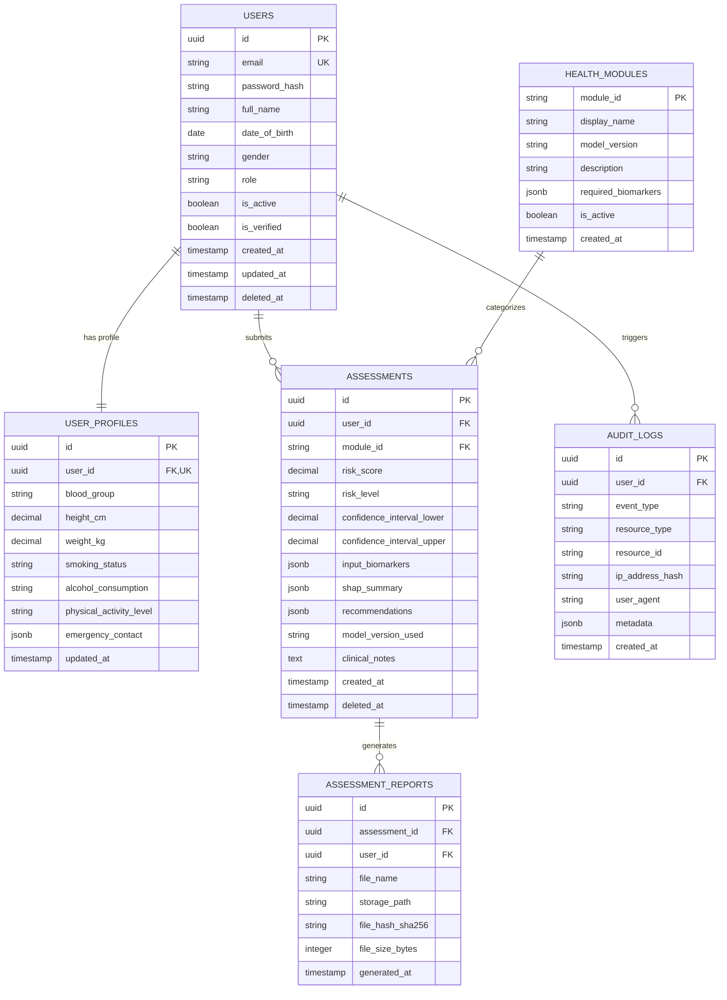

# HealthSync AI — Database Design & Security Specification

> **Official Project Title:** AI-Enabled Smart Health Monitoring System  
> **Product Name:** HealthSync AI  
> **Version:** 1.0.0  
> **Database Engine:** PostgreSQL 15+ (Hosted on Supabase)  
> **ORM Layer:** SQLAlchemy 2.0 (Async) + Alembic  
> **Security Baseline:** Cryptographic Tenancy & Row Level Security (RLS)  

---

## 1. Cloud Database Provider Evaluation: Supabase PostgreSQL & RLS

### 1.1 Supabase Architecture Overview
Supabase is an open-source Firebase alternative built on an unabstracted, enterprise-grade **PostgreSQL** relational database. Key capabilities evaluated for HealthSync AI include:
1. **Native PostgreSQL Engine:** Full support for ACID transactions, robust extensions (`pgcrypto`, `uuid-ossp`, `citext`), complex analytical window functions, and rich JSONB indexing.
2. **Row Level Security (RLS):** Kernel-level security policies that intercept and filter every query at the SQL engine level based on the executing role's security context.
3. **Connection Pooling (Supavisor):** Manages concurrent database connections efficiently for stateless serverless or containerized backend instances.
4. **Automated Backups & Point-in-Time Recovery (PITR):** Safeguards health data against accidental corruption or data loss.

### 1.2 Evaluation of Row Level Security (RLS) Capabilities

```
+-----------------------------------------------------------------------------------+
|                           PostgreSQL RLS Execution Flow                           |
|                                                                                   |
|  +--------------------+                                                           |
|  | Client SQL Query   |  --> SELECT * FROM assessments;                           |
|  +--------------------+                                                           |
|            |                                                                      |
|            v                                                                      |
|  +--------------------+                                                           |
|  | PostgreSQL Engine  |  --> Reads current_setting('request.jwt.claim.sub')       |
|  +--------------------+                                                           |
|            |                                                                      |
|            v                                                                      |
|  +--------------------+                                                           |
|  |  RLS Policy Filter |  --> WHERE user_id = auth.uid()                           |
|  +--------------------+                                                           |
|            |                                                                      |
|            v                                                                      |
|  +--------------------+                                                           |
|  | Isolated ResultSet |  --> Returns ONLY records owned by authenticated user     |
|  +--------------------+                                                           |
+-----------------------------------------------------------------------------------+
```

#### Strengths for Healthcare Architecture
- **Defense in Depth:** Even if a backend API endpoint contains a software bug or missing `WHERE user_id = :id` clause, the database itself denies unauthorized cross-tenant row access.
- **Auditable Security:** Security rules are declared centrally in SQL migrations rather than dispersed across various Python controller files.
- **Granular Operation Control:** Independent policies can be assigned for `SELECT`, `INSERT`, `UPDATE`, and `DELETE`.

#### Dual-Access Pattern for HealthSync AI
1. **Frontend Isolation Rule:** The React frontend **NEVER** connects directly to Supabase via client-side keys for health data. Direct client access would bypass our in-memory ML model inference pipelines, SHAP explainability calculations, and HIPAA audit logging.
2. **Backend Gateway Access:** The FastAPI backend connects to PostgreSQL using the authorized application role. When serving user requests, the backend sets the tenant session variable (`SET LOCAL request.jwt.claim.sub = :user_id`) or executes queries within user-scoped contexts so that PostgreSQL RLS is always enforced.

---

## 2. Entity-Relationship Diagram (ERD)



---

## 3. Relational Schema DDL (PostgreSQL 15+)

Below is the complete database definition including custom enumerated types, constraints, and indexes:

```sql
-- ============================================================================
-- HealthSync AI — Relational Schema Definition
-- ============================================================================

-- 1. Enable Required Extensions
CREATE EXTENSION IF NOT EXISTS "uuid-ossp";
CREATE EXTENSION IF NOT EXISTS "pgcrypto";
CREATE EXTENSION IF NOT EXISTS "citext";

-- 2. Enumerated Types
CREATE TYPE user_role_enum AS ENUM ('patient', 'clinician', 'admin');
CREATE TYPE risk_level_enum AS ENUM ('LOW', 'MODERATE', 'HIGH', 'CRITICAL');
CREATE TYPE biological_sex_enum AS ENUM ('MALE', 'FEMALE', 'OTHER');
CREATE TYPE smoking_status_enum AS ENUM ('NEVER', 'FORMER', 'CURRENT');
CREATE TYPE alcohol_consumption_enum AS ENUM ('NONE', 'MODERATE', 'HEAVY');
CREATE TYPE activity_level_enum AS ENUM ('SEDENTARY', 'MODERATE', 'ACTIVE');

-- 3. Users Table (Core Identity)
CREATE TABLE users (
    id UUID PRIMARY KEY DEFAULT uuid_generate_v4(),
    email CITEXT NOT NULL UNIQUE,
    password_hash VARCHAR(255) NOT NULL,
    full_name VARCHAR(150) NOT NULL,
    date_of_birth DATE NOT NULL,
    gender biological_sex_enum NOT NULL,
    role user_role_enum NOT NULL DEFAULT 'patient',
    is_active BOOLEAN NOT NULL DEFAULT TRUE,
    is_verified BOOLEAN NOT NULL DEFAULT FALSE,
    created_at TIMESTAMPTZ NOT NULL DEFAULT CURRENT_TIMESTAMP,
    updated_at TIMESTAMPTZ NOT NULL DEFAULT CURRENT_TIMESTAMP,
    deleted_at TIMESTAMPTZ NULL -- Supports soft-deletes / GDPR
);

CREATE INDEX idx_users_email ON users(email) WHERE deleted_at IS NULL;
CREATE INDEX idx_users_role ON users(role);

-- 4. User Profiles Table (Physiological Baseline)
CREATE TABLE user_profiles (
    id UUID PRIMARY KEY DEFAULT uuid_generate_v4(),
    user_id UUID NOT NULL UNIQUE REFERENCES users(id) ON DELETE CASCADE,
    blood_group VARCHAR(5) NULL,
    height_cm NUMERIC(5, 2) NULL CHECK (height_cm > 40 AND height_cm < 300),
    weight_kg NUMERIC(5, 2) NULL CHECK (weight_kg > 10 AND weight_kg < 500),
    smoking_status smoking_status_enum NOT NULL DEFAULT 'NEVER',
    alcohol_consumption alcohol_consumption_enum NOT NULL DEFAULT 'NONE',
    physical_activity_level activity_level_enum NOT NULL DEFAULT 'MODERATE',
    emergency_contact JSONB NULL,
    updated_at TIMESTAMPTZ NOT NULL DEFAULT CURRENT_TIMESTAMP
);

CREATE INDEX idx_user_profiles_user_id ON user_profiles(user_id);

-- 5. Health Modules Catalog
CREATE TABLE health_modules (
    module_id VARCHAR(50) PRIMARY KEY,
    display_name VARCHAR(100) NOT NULL,
    model_version VARCHAR(20) NOT NULL,
    description TEXT NOT NULL,
    required_biomarkers JSONB NOT NULL,
    is_active BOOLEAN NOT NULL DEFAULT TRUE,
    created_at TIMESTAMPTZ NOT NULL DEFAULT CURRENT_TIMESTAMP
);

INSERT INTO health_modules (module_id, display_name, model_version, description, required_biomarkers)
VALUES 
(
    'diabetes', 
    'Type 2 Diabetes Risk Estimator', 
    'v1.0.0', 
    'Estimates prediabetes and type 2 diabetes susceptibility based on metabolic vitals and lifestyle indicators.',
    '["glucose", "blood_pressure_systolic", "blood_pressure_diastolic", "bmi", "age", "physical_activity", "cholesterol_level"]'::jsonb
),
(
    'heart_disease', 
    'Cardiovascular Risk Estimator', 
    'v1.0.0', 
    'Assesses cardiovascular vulnerability based on clinical markers including chest pain profile, serum cholesterol, and resting ECG.',
    '["age", "sex", "chest_pain_type", "resting_bp", "serum_cholesterol", "fasting_blood_sugar", "resting_ecg", "max_heart_rate", "exercise_angina"]'::jsonb
);

-- 6. Health Assessments Table
CREATE TABLE assessments (
    id UUID PRIMARY KEY DEFAULT uuid_generate_v4(),
    user_id UUID NOT NULL REFERENCES users(id) ON DELETE CASCADE,
    module_id VARCHAR(50) NOT NULL REFERENCES health_modules(module_id),
    risk_score NUMERIC(5, 4) NOT NULL CHECK (risk_score >= 0.0 AND risk_score <= 1.0),
    risk_level risk_level_enum NOT NULL,
    confidence_interval_lower NUMERIC(5, 4) NOT NULL CHECK (confidence_interval_lower >= 0.0),
    confidence_interval_upper NUMERIC(5, 4) NOT NULL CHECK (confidence_interval_upper <= 1.0),
    input_biomarkers JSONB NOT NULL,
    shap_summary JSONB NOT NULL,
    recommendations JSONB NOT NULL,
    model_version_used VARCHAR(50) NOT NULL,
    clinical_notes TEXT NULL,
    created_at TIMESTAMPTZ NOT NULL DEFAULT CURRENT_TIMESTAMP,
    deleted_at TIMESTAMPTZ NULL
);

-- Critical Indexes for Dashboard Performance
CREATE INDEX idx_assessments_user_history ON assessments(user_id, created_at DESC) WHERE deleted_at IS NULL;
CREATE INDEX idx_assessments_module_filter ON assessments(user_id, module_id, created_at DESC) WHERE deleted_at IS NULL;
CREATE INDEX idx_assessments_gin_biomarkers ON assessments USING gin(input_biomarkers);

-- 7. Assessment Reports (PDF Storage Metadata)
CREATE TABLE assessment_reports (
    id UUID PRIMARY KEY DEFAULT uuid_generate_v4(),
    assessment_id UUID NOT NULL REFERENCES assessments(id) ON DELETE CASCADE,
    user_id UUID NOT NULL REFERENCES users(id) ON DELETE CASCADE,
    file_name VARCHAR(255) NOT NULL,
    storage_path VARCHAR(500) NOT NULL,
    file_hash_sha256 CHAR(64) NOT NULL,
    file_size_bytes INTEGER NOT NULL,
    generated_at TIMESTAMPTZ NOT NULL DEFAULT CURRENT_TIMESTAMP
);

CREATE INDEX idx_assessment_reports_assessment_id ON assessment_reports(assessment_id);
CREATE INDEX idx_assessment_reports_user_id ON assessment_reports(user_id);

-- 8. Audit Logs Table (Immutable Compliance Trail)
CREATE TABLE audit_logs (
    id UUID PRIMARY KEY DEFAULT uuid_generate_v4(),
    user_id UUID NULL REFERENCES users(id) ON DELETE SET NULL,
    event_type VARCHAR(100) NOT NULL, -- 'ASSESSMENT_CREATED', 'REPORT_DOWNLOADED', 'ACCOUNT_LOGIN', 'DATA_EXPORT_REQUESTED'
    resource_type VARCHAR(50) NOT NULL,
    resource_id VARCHAR(100) NULL,
    ip_address_hash CHAR(64) NOT NULL, -- SHA256 anonymized IP for privacy
    user_agent VARCHAR(255) NULL,
    metadata JSONB NULL,
    created_at TIMESTAMPTZ NOT NULL DEFAULT CURRENT_TIMESTAMP
);

CREATE INDEX idx_audit_logs_user_id ON audit_logs(user_id);
CREATE INDEX idx_audit_logs_event_type ON audit_logs(event_type);
CREATE INDEX idx_audit_logs_created_at ON audit_logs(created_at DESC);
```

---

## 4. Row Level Security (RLS) Policy Specifications

To guarantee zero cross-tenant leakage at the storage engine level, RLS is explicitly enabled on all user-linked tables:

```sql
-- ============================================================================
-- Row Level Security (RLS) Configuration
-- ============================================================================

-- Enable RLS on All Protected Tables
ALTER TABLE users ENABLE ROW LEVEL SECURITY;
ALTER TABLE user_profiles ENABLE ROW LEVEL SECURITY;
ALTER TABLE assessments ENABLE ROW LEVEL SECURITY;
ALTER TABLE assessment_reports ENABLE ROW LEVEL SECURITY;
ALTER TABLE audit_logs ENABLE ROW LEVEL SECURITY;

-- ----------------------------------------------------------------------------
-- 1. Policies for `users` Table
-- ----------------------------------------------------------------------------
-- Users can only read their own user record
CREATE POLICY user_read_own ON users
    FOR SELECT
    USING (id = NULLIF(current_setting('request.jwt.claim.sub', true), '')::uuid);

-- Users can only update their own record
CREATE POLICY user_update_own ON users
    FOR UPDATE
    USING (id = NULLIF(current_setting('request.jwt.claim.sub', true), '')::uuid)
    WITH CHECK (id = NULLIF(current_setting('request.jwt.claim.sub', true), '')::uuid);

-- ----------------------------------------------------------------------------
-- 2. Policies for `user_profiles` Table
-- ----------------------------------------------------------------------------
CREATE POLICY profile_read_own ON user_profiles
    FOR SELECT
    USING (user_id = NULLIF(current_setting('request.jwt.claim.sub', true), '')::uuid);

CREATE POLICY profile_insert_own ON user_profiles
    FOR INSERT
    WITH CHECK (user_id = NULLIF(current_setting('request.jwt.claim.sub', true), '')::uuid);

CREATE POLICY profile_update_own ON user_profiles
    FOR UPDATE
    USING (user_id = NULLIF(current_setting('request.jwt.claim.sub', true), '')::uuid)
    WITH CHECK (user_id = NULLIF(current_setting('request.jwt.claim.sub', true), '')::uuid);

-- ----------------------------------------------------------------------------
-- 3. Policies for `assessments` Table
-- ----------------------------------------------------------------------------
-- Users can query only their own non-deleted assessments
CREATE POLICY assessment_read_own ON assessments
    FOR SELECT
    USING (
        user_id = NULLIF(current_setting('request.jwt.claim.sub', true), '')::uuid 
        AND deleted_at IS NULL
    );

-- Users can insert assessments only for their authenticated identity
CREATE POLICY assessment_insert_own ON assessments
    FOR INSERT
    WITH CHECK (user_id = NULLIF(current_setting('request.jwt.claim.sub', true), '')::uuid);

-- Users can soft-delete their own assessments
CREATE POLICY assessment_delete_own ON assessments
    FOR UPDATE
    USING (user_id = NULLIF(current_setting('request.jwt.claim.sub', true), '')::uuid)
    WITH CHECK (user_id = NULLIF(current_setting('request.jwt.claim.sub', true), '')::uuid);

-- ----------------------------------------------------------------------------
-- 4. Policies for `assessment_reports` Table
-- ----------------------------------------------------------------------------
CREATE POLICY reports_read_own ON assessment_reports
    FOR SELECT
    USING (user_id = NULLIF(current_setting('request.jwt.claim.sub', true), '')::uuid);

CREATE POLICY reports_insert_own ON assessment_reports
    FOR INSERT
    WITH CHECK (user_id = NULLIF(current_setting('request.jwt.claim.sub', true), '')::uuid);

-- ----------------------------------------------------------------------------
-- 5. Policies for `audit_logs` Table
-- ----------------------------------------------------------------------------
-- Regular users cannot read audit logs (reserved for security administrators)
CREATE POLICY audit_logs_admin_only ON audit_logs
    FOR SELECT
    USING (
        EXISTS (
            SELECT 1 FROM users 
            WHERE id = NULLIF(current_setting('request.jwt.claim.sub', true), '')::uuid 
            AND role = 'admin'
        )
    );

-- Backend service role maintains bypass privileges for system-level operations
```

---

## 5. Data Isolation, Privacy Rights & Lifecycle Management

### 5.1 Soft Deletions and GDPR "Right to be Forgotten"
- **Soft Deletion (`deleted_at`):** When a user requests deletion of an individual assessment or their entire account, records are flagged with `deleted_at = CURRENT_TIMESTAMP`. Application queries immediately filter out soft-deleted records.
- **Hard Purge Lifecycle:** A scheduled background maintenance worker executes a permanent cryptographic hard-purge for records where `deleted_at < NOW() - INTERVAL '30 days'`, giving users a 30-day grace period while guaranteeing permanent GDPR-compliant erasure thereafter.
- **Full Account Purge Routine:**
  ```sql
  CREATE OR REPLACE FUNCTION purge_user_data(target_user_id UUID) 
  RETURNS VOID AS $$
  BEGIN
      -- Cascade delete will remove user_profiles, assessments, and reports
      DELETE FROM users WHERE id = target_user_id;
      -- Anonymize user_id reference in audit_logs to preserve security compliance history
      UPDATE audit_logs SET user_id = NULL, metadata = metadata || '{"anonymized": true}'::jsonb 
      WHERE user_id = target_user_id;
  END;
  $$ LANGUAGE plpgsql SECURITY DEFINER;
  ```

### 5.2 Biomarker Data Encryption at Rest
- Sensitive user biomarker vectors in `input_biomarkers` and `shap_summary` can be optionally encrypted using PostgreSQL's `pgp_sym_encrypt()` or application-level AES-256-GCM authenticated encryption before persistence, ensuring that even direct database dumps do not reveal plaintext biometric telemetry without the backend master key.

### 5.3 Automated Timestamp Triggers
Each table with an `updated_at` column is secured with an automated PostgreSQL trigger:
```sql
CREATE OR REPLACE FUNCTION update_timestamp_column()
RETURNS TRIGGER AS $$
BEGIN
    NEW.updated_at = CURRENT_TIMESTAMP;
    RETURN NEW;
END;
$$ LANGUAGE plpgsql;

CREATE TRIGGER trg_users_updated_at BEFORE UPDATE ON users FOR EACH ROW EXECUTE FUNCTION update_timestamp_column();
CREATE TRIGGER trg_profiles_updated_at BEFORE UPDATE ON user_profiles FOR EACH ROW EXECUTE FUNCTION update_timestamp_column();
```
