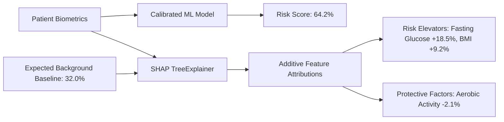

# HealthSync AI — Machine Learning & Explainable AI (XAI) Design

> **Official Project Title:** AI-Enabled Smart Health Monitoring System  
> **Product Name:** HealthSync AI  
> **Version:** 1.0.0  
> **Framework:** Scikit-learn + SHAP (SHapley Additive exPlanations)  
> **Inference Engine:** In-Memory Backend Scoring (FastAPI)  
> **Ethical Principle:** Transparent, Calibrated, Non-Diagnostic Risk Scoring  

---

## 1. Machine Learning System Philosophy & Scientific Principles

### 1.1 Informational Risk Screening vs. Medical Diagnosis
HealthSync AI operates under strict clinical and regulatory boundaries:
- **Mathematical Estimations:** Predictions are treated as probabilistic risk assessments based on empirical epidemiological associations found in training datasets.
- **Strict Prohibition Against Fabricated Performance:** No theoretical accuracy figures, clinical validation claims, or patient statistics may be invented. All evaluation metrics (AUC-ROC, Brier Score, Sensitivity, Specificity) must be computed transparently from reproducible cross-validation scripts and logged in `metrics.json`.
- **Absolute Ban on Hardcoded or Mocked AI Predictions:** Every score and SHAP value must be dynamically derived by executing calibrated serialized model pipelines against user input vectors.

### 1.2 Strict Tripartite Data Separation
Data integrity is maintained through strict isolation of three distinct data realms:

```
+---------------------------------------------------------------------------------+
|                               Data Realm Separation                             |
|                                                                                 |
|  1. RESEARCH & TRAINING DATASET REALM (ml/data/)                                |
|     - Publicly available, de-identified research cohorts (CDC BRFSS, UCI).      |
|     - Used solely for offline exploratory analysis, feature selection, training |
|       and baseline SHAP background calculation.                                 |
|                                                                                 |
|  2. DEMONSTRATION & SYNTHETIC DATA REALM (tests/fixtures/)                      |
|     - Programmatically synthesized patient profiles.                            |
|     - Used exclusively in automated CI/CD unit and integration test suites.     |
|     - Zero overlap with real human identities.                                  |
|                                                                                 |
|  3. ACTUAL USER & CLINICAL TELEMETRY REALM (PostgreSQL Database)                |
|     - Live biomarker telemetry submitted by authenticated users.                |
|     - Isolated via Row Level Security (RLS) and stored with encryption.         |
|     - NEVER mixed with training datasets or logged into code repositories.       |
+---------------------------------------------------------------------------------+
```

---

## 2. Chronic Disease Risk Modules Specification

### 2.1 Module 1: Type 2 Diabetes Risk Estimation

#### Reference Research Datasets
- **Primary Research Baseline:** CDC Behavioral Risk Factor Surveillance System (BRFSS) Diabetes Health Indicators (public health cohort of 253,680 survey respondents) and the National Institute of Diabetes and Digestive and Kidney Diseases (NIDDK / Pima Indians) clinical benchmark.
- **Target Label:** Binary classification ($y \in \{0, 1\}$) where $1$ designates diagnosed diabetes / prediabetes.

#### Biometric & Lifestyle Input Features
| Feature Name | Clinical Description | Data Type | Permissible Range | Preprocessing |
| :--- | :--- | :--- | :--- | :--- |
| `glucose` | Fasting blood plasma glucose | Float | 40.0 – 400.0 mg/dL | RobustScaler |
| `blood_pressure_systolic` | Resting systolic blood pressure | Float | 60.0 – 250.0 mmHg | RobustScaler |
| `blood_pressure_diastolic`| Resting diastolic blood pressure | Float | 40.0 – 150.0 mmHg | RobustScaler |
| `bmi` | Body Mass Index ($\text{weight}/\text{height}^2$) | Float | 10.0 – 65.0 kg/m² | RobustScaler |
| `age` | Chronological age | Integer | 18 – 120 years | StandardScaler |
| `insulin` | 2-Hour serum insulin | Float | 0.0 – 900.0 µU/mL | Log-transform + Impute |
| `skin_thickness` | Triceps skin fold thickness | Float | 0.0 – 99.0 mm | Median Impute |
| `pregnancies` | Number of times pregnant (if applicable) | Integer | 0 – 20 | Pass-through |
| `physical_activity` | Aerobic activity in past 30 days | Boolean | 0 or 1 | Binary indicator |
| `family_history` | Direct parental/sibling diabetes history | Boolean | 0 or 1 | Binary indicator |

#### Candidate Model Architectures
1. **Histogram-based Gradient Boosting (`HistGradientBoostingClassifier`):** Native handling of missing values, high non-linear interaction modeling, fast inference speed.
2. **Random Forest Classifier (`RandomForestClassifier`):** Robust to outliers, balanced variance-bias tradeoff.
3. **Calibrated Logistic Regression (L2 Regularization):** Highly interpretable baseline used for comparative benchmarking.

---

### 2.2 Module 2: Cardiovascular / Heart Disease Risk Estimation

#### Reference Research Datasets
- **Primary Research Baseline:** UCI Machine Learning Repository Heart Disease Dataset (combining Cleveland, Hungarian, Switzerland, and Long Beach V.A. cohorts; 920 total clinical records) and CDC BRFSS Heart Disease survey data.
- **Target Label:** Binary classification ($y \in \{0, 1\}$) where $1$ designates presence of significant coronary artery disease ($\ge 50\%$ diameter narrowing).

#### Clinical Input Features
| Feature Name | Clinical Description | Type / Scale | Permissible Values |
| :--- | :--- | :--- | :--- |
| `age` | Chronological age | Integer | 18 – 120 |
| `sex` | Biological sex | Categorical | 0 = Female, 1 = Male |
| `chest_pain_type` | Chest pain classification | Categorical (0-3) | 0: Typical Angina, 1: Atypical Angina, 2: Non-anginal, 3: Asymptomatic |
| `resting_bp` | Resting blood pressure | Float | 60.0 – 260.0 mmHg |
| `serum_cholesterol` | Serum cholesterol | Float | 100.0 – 600.0 mg/dL |
| `fasting_blood_sugar` | Fasting blood sugar $> 120\text{ mg/dL}$ | Boolean | 0 = False, 1 = True |
| `resting_ecg` | Resting electrocardiographic results | Categorical (0-2) | 0: Normal, 1: ST-T wave abnormality, 2: Left ventricular hypertrophy |
| `max_heart_rate` | Maximum heart rate achieved (`thalach`) | Float | 60.0 – 220.0 bpm |
| `exercise_angina` | Exercise induced angina (`exang`) | Boolean | 0 = No, 1 = Yes |
| `oldpeak` | ST depression induced by exercise | Float | 0.0 – 10.0 mm |
| `st_slope` | Slope of peak exercise ST segment | Categorical (0-2) | 0: Upsloping, 1: Flat, 2: Downsloping |

---

## 3. Probability Calibration Strategy

In clinical risk scoring, raw uncalibrated decision-tree probabilities often cluster near extremes or reflect internal margin distances rather than true statistical likelihoods. HealthSync AI mandates **Probability Calibration**:

```
+---------------------------------------------------------------------------------+
|                       Probability Calibration Architecture                      |
|                                                                                 |
|  +--------------------+                                                         |
|  | Base Tree Ensemble |  --> Outputs raw confidence score f(x)                  |
|  +--------------------+                                                         |
|            |                                                                    |
|            v                                                                    |
|  +--------------------+                                                         |
|  | CalibratedClassifier|  --> Passes through Sigmoid (Platt Scaling) or          |
|  | CV (Isotonic/Platt)|      Isotonic Regression mapping f(x) -> P(Y=1|X)       |
|  +--------------------+                                                         |
|            |                                                                    |
|            v                                                                    |
|  +--------------------+                                                         |
|  |  Calibrated Risk   |  --> An assigned risk of 0.65 corresponds to a 65%      |
|  |     Percentage     |      empirical incidence in identical cohorts           |
|  +--------------------+                                                         |
+---------------------------------------------------------------------------------+
```

### 3.1 Verification Metrics
- **Brier Score:** Mean squared difference between predicted probabilities and actual binary outcomes ($\text{Brier} = \frac{1}{N}\sum_{t=1}^N (f_t - o_t)^2$). A Brier score approaching 0 indicates optimal probabilistic calibration.
- **Expected Calibration Error (ECE):** Partitions predictions into $M$ bins and measures the weighted average difference between bin accuracy and bin confidence.
- **Area Under the ROC Curve (AUC-ROC) & PR-AUC:** Measures discrimination capability independent of threshold choice.

---

## 4. Explainable AI (XAI) Architecture with SHAP

Explainability transforms a black-box percentage into an actionable clinical dialogue:



### 4.1 Mathematical Foundation: Shapley Values
SHAP assigns each feature $i$ an additive attribution value $\phi_i$ satisfying the local efficiency property:
$$f(x) = \phi_0 + \sum_{i=1}^M \phi_i$$
where $\phi_0 = \mathbb{E}[f(z)]$ is the baseline expected risk over a representative reference dataset, and $\phi_i$ is the positive or negative contribution of feature $i$.

### 4.2 Implementation Mechanics
- **Explainer Selection:** `shap.TreeExplainer` is employed for tree ensemble models. TreeExplainer computes exact Shapley values in polynomial time ($O(TLD^2)$), running in **sub-60ms** within the backend worker.
- **Background Summary:** A k-means or medoid clustering summary of 100 representative points from the training distribution is computed offline and serialized (`background_summary.joblib`) to anchor baseline expectations.
- **Clinical Feature Mapping:** Raw mathematical attribution values are mapped into human-understandable clinical descriptors via an attribution translation dictionary:

```python
def format_shap_drivers(shap_values, feature_names, feature_values, top_k=5):
    # Sort features by absolute attribution impact
    drivers = []
    for name, val, impact in zip(feature_names, feature_values, shap_values):
        drivers.append({
            "feature": name,
            "value": val,
            "shap_impact": round(float(impact), 4),
            "direction": "RISK_ELEVATING" if impact > 0 else "PROTECTIVE"
        })
    drivers.sort(key=lambda x: abs(x["shap_impact"]), reverse=True)
    return {
        "risk_drivers": [d for d in drivers if d["direction"] == "RISK_ELEVATING"][:top_k],
        "protective_factors": [d for d in drivers if d["direction"] == "PROTECTIVE"][:top_k]
    }
```

---

## 5. Model Serialization & Packaging Schema

Every deployable model is bundled into a self-contained directory under `backend/app/artifacts/{module_id}/`:

```
backend/app/artifacts/diabetes/
├── model.joblib                  # Serialized Scikit-learn Pipeline (Preprocessor + CalibratedClassifierCV)
├── background.joblib             # 100-sample k-means background for SHAP TreeExplainer
└── metadata.json                 # Provenance, feature schema, calibration & metrics
```

### `metadata.json` Schema
```json
{
  "module_id": "diabetes",
  "model_version": "v1.0.0",
  "training_timestamp": "2026-10-01T20:00:00Z",
  "git_commit_hash": "a1b2c3d4e5f6...",
  "training_dataset": "CDC_BRFSS_Diabetes_Cleaned_v1",
  "algorithm": "CalibratedClassifierCV(HistGradientBoostingClassifier)",
  "calibration_method": "isotonic",
  "evaluation_metrics": {
    "cv_folds": 5,
    "brier_score": 0.1245,
    "auc_roc": 0.8312,
    "pr_auc": 0.7645,
    "expected_calibration_error": 0.021
  },
  "features": [
    {"name": "glucose", "dtype": "float64", "min_allowed": 40.0, "max_allowed": 400.0},
    {"name": "bmi", "dtype": "float64", "min_allowed": 10.0, "max_allowed": 65.0}
  ],
  "expected_baseline_risk": 0.3204
}
```

---

## 6. Safe In-Memory Backend Inference Lifecycle

To ensure fast response times and avoid cold-start delays:
1. **Startup Warming:** During FastAPI application startup (`lifespan` event), the `RiskEngineRegistry` loads each `.joblib` model pipeline and SHAP explainer into memory once.
2. **Bounds Checking:** Incoming API payloads are checked against the hard physiological limits declared in `metadata.json` before hitting the scikit-learn pipeline.
3. **Execution Safety:** All inference operations are wrapped in CPU timeout guards and fail-safe try-except handlers returning standard RFC 7807 problem details if anomalous inputs trigger mathematical divergence.
