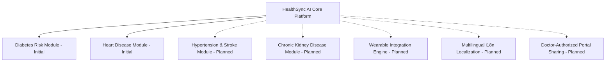

# HealthSync AI — Project Overview

> **Project Title:** AI-Enabled Smart Health Monitoring System  
> **Product Name:** HealthSync AI  
> **Classification:** Academic Major Project (B.Tech Computer Science & Engineering) transitioning to an Extensible Healthcare Product  
> **Architectural Pattern:** Modular Monorepo (Frontend, Backend, Machine Learning Pipelines)  
> **Target Release:** Version 1.0.0-MVP  

---

## 1. Executive Summary

**HealthSync AI** is an intelligent, privacy-first preventative health monitoring platform. It combines clinically grounded machine learning risk models, local explainable AI (XAI) using SHAP (SHapley Additive exPlanations), a secure FastAPI backend, a responsive React/TypeScript user interface, and an enterprise-grade PostgreSQL database with Row Level Security (RLS).

The system empowers individuals to proactively screen their statistical vulnerability to chronic lifestyle diseases—initially **Type 2 Diabetes Mellitus** and **Cardiovascular / Heart Disease**—and understand the key biometric and lifestyle drivers contributing to their risk scores.

```
       +-------------------------------------------------------------+
       |                        HealthSync AI                        |
       |          AI-Enabled Smart Health Monitoring System          |
       +-------------------------------------------------------------+
                                      |
         +----------------------------+----------------------------+
         |                                                         |
+------------------+                                     +------------------+
|  Preventative    |                                     |   Explainable    |
|  Risk Estimation |                                     |   AI Reasoning   |
|  (Diabetes/Heart)|                                     |     (SHAP)       |
+------------------+                                     +------------------+
         |                                                         |
         +----------------------------+----------------------------+
                                      |
         +----------------------------+----------------------------+
         |                                                         |
+------------------+                                     +------------------+
|  Personal Health |                                     |   Clinical PDF   |
|    Dashboard     |                                     |  Health Reports  |
+------------------+                                     +------------------+
```

---

## 2. Fundamental Mission & Medical Non-Diagnostic Boundary

### 2.1 Mission Statement
To democratize preventative health screening by translating complex physiological parameters into transparent, calibrated risk indications and actionable lifestyle insights—bridging the gap between asymptomatic disease onset and formal clinical evaluation.

### 2.2 Strict Non-Diagnostic Medical Disclaimer
> [!CAUTION]
> **IMPORTANT REGULATORY & CLINICAL DISCLAIMER**  
> HealthSync AI is **not** a medical device, diagnostic tool, or substitute for professional medical advice, clinical diagnosis, or treatment. All predictions, risk percentages, categories, and feature attribution values generated by this platform are mathematical estimations derived from statistical patterns in public research datasets.  
> 
> * The software must **never** be used in emergency clinical situations or acute diagnostic triage.
> * Users must **always** seek the advice of a qualified physician or licensed healthcare provider with any questions regarding personal medical conditions or biomarker interpretations.
> * The software interface, API responses, generated PDF documents, and developer documentation must systematically display this disclaimer.

---

## 3. Core Initial Capabilities (Phase 1 MVP)

| Capability | Technical Mechanism | User Value |
| :--- | :--- | :--- |
| **Diabetes Risk Estimation** | Calibrated gradient boosting / logistic classifier trained on benchmark datasets (e.g., CDC BRFSS / Pima Indian diabetes data) | Identifies statistical propensity for prediabetes / diabetes based on glucose, BMI, age, blood pressure, and lifestyle metrics. |
| **Heart Disease Risk Estimation** | Ensemble classification models trained on validated cardiovascular datasets (e.g., UCI Cleveland / Statlog) | Evaluates cardiovascular vulnerability based on blood pressure, serum cholesterol, resting ECG, chest pain profile, and exercise metrics. |
| **Explainable AI (XAI)** | Local TreeExplainer / KernelExplainer computing exact SHapley Additive exPlanations (SHAP) | Explains *why* a particular score was assigned; surfaces the top positive (risk-elevating) and negative (protective) biometric factors. |
| **Personal Health Dashboard** | React 18+ Single Page Application with dynamic trend visualizations (Recharts / Chart.js) | Displays health trajectories, historical scores, biomarker changes, and actionable preventative guidance over time. |
| **Assessment History** | PostgreSQL transactional tracking with user isolation | Allows users to inspect previous risk assessments, compare delta changes, and observe the impact of lifestyle modifications. |
| **Standardized PDF Health Reports** | High-fidelity server-side PDF generation (ReportLab / WeasyPrint) | Generates tamper-evident, structured summary documents suitable for sharing with a consulting physician during physical checkups. |
| **Secure Cloud Database** | PostgreSQL hosted on Supabase with Row Level Security (RLS) | Enforces cryptographic user tenancy isolation; users can only access their own biometric records even in multi-tenant queries. |
| **Local Backend ML Inference** | Direct in-memory scikit-learn model scoring within the FastAPI runtime | Zero dependence on third-party cloud AI APIs (OpenAI, Anthropic); patient biomarkers never leave the controlled backend boundary. |

---

## 4. Future Expansion Horizons

The system is designed around a **Modular Risk Engine Registry Pattern**, enabling rapid incorporation of subsequent modules without altering the core authentication, persistence, or presentation layers:



1. **Additional Clinical Health Modules:**
   - Hypertension & Stroke probability estimation.
   - Chronic Kidney Disease (CKD) staging indicators.
   - Non-Alcoholic Fatty Liver Disease (NAFLD) risk scoring.
2. **Wearable Device Integration:**
   - Automated ingestion of resting heart rate, step counts, sleep latency, and heart rate variability (HRV) from Apple HealthKit, Google Health Connect, and Fitbit Web API.
3. **Multilingual Interface:**
   - Full internationalization (i18n) supporting regional languages (Hindi, Spanish, French, etc.) for broader accessibility in diverse healthcare demographics.
4. **Doctor-Authorized Report Sharing:**
   - Time-bound, cryptographically signed access tokens and clinician review portals allowing medical practitioners to inspect audit-verified patient assessments.

---

## 5. Architectural Principles

1. **Decoupled Modular Monorepo:** Separate directories for `frontend`, `backend`, and `ml`, allowing independent scaling, testing, and lifecycle management while maintaining shared API contracts.
2. **Privacy by Design:** Zero-trust database access, data minimization, strict isolation of protected health information (PHI), and strict alignment with HIPAA and GDPR data governance standards.
3. **Calibrated & Transparent Intelligence:** No black-box predictions; probability calibration ensures scores correspond to empirical risk rates, accompanied by local SHAP explanations.
4. **Stateless API Gateway:** The FastAPI backend serves as an authenticated, stateless intermediary between client applications, local ML engines, and the relational database.
5. **No Secret Leakage:** Complete exclusion of database credentials, private signing keys, and service keys from frontend code bundles.
